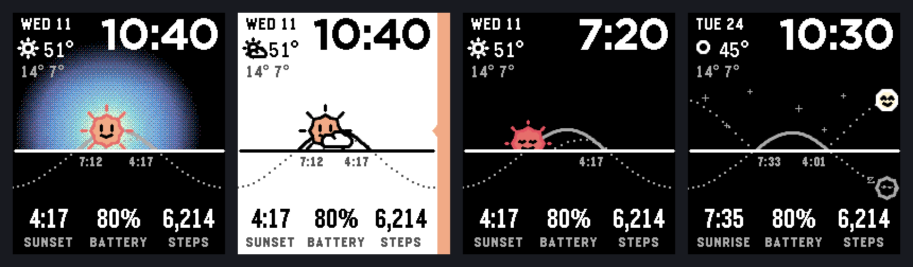
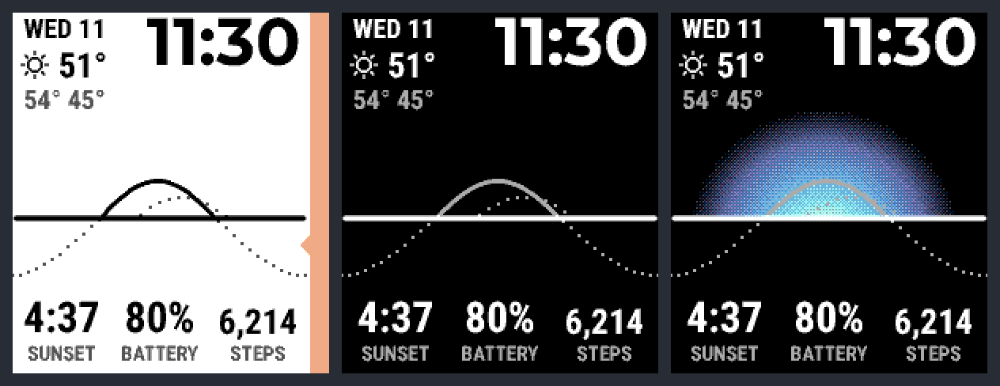
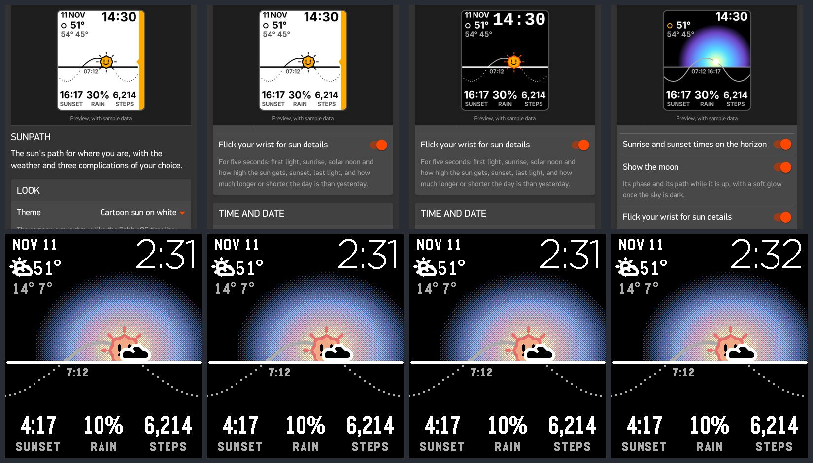
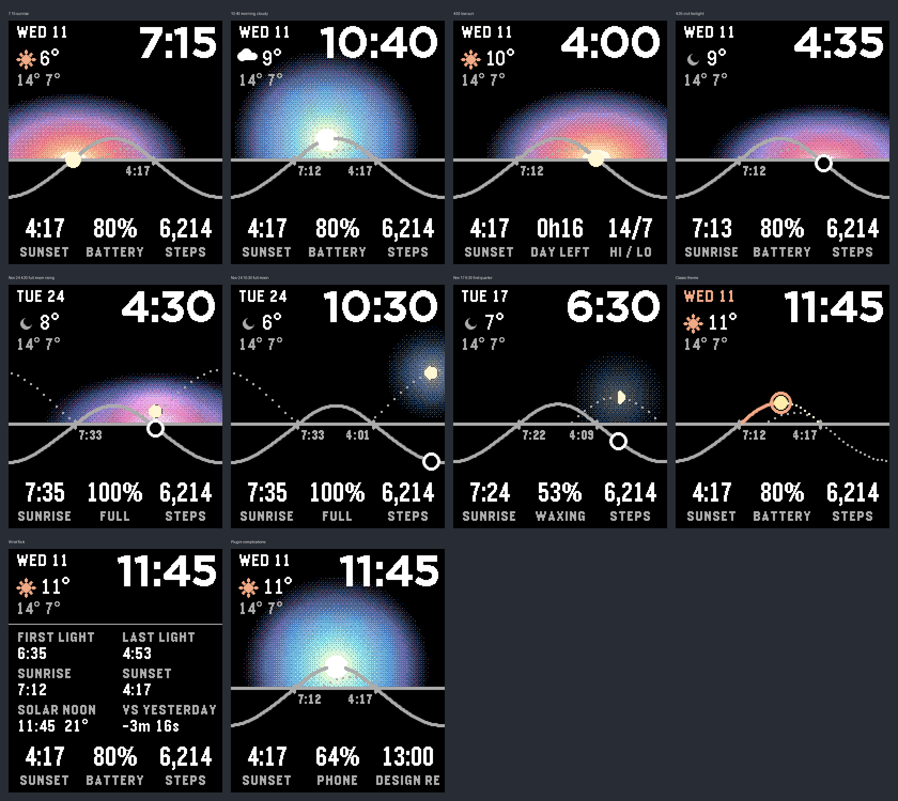

# Sunpath

A solar-graph watchface for the **Pebble Time 2**, after the Solar face on the Apple Watch: the sun's real
elevation for where you are, drawn across the day, with the sun marking now. Around it are the time, the date,
the current weather and three complications you choose.



The cartoon sun wakes up when the face appears and when the wrist-flick card closes:



The settings page shows a live preview of your choices:



Earlier looks, before the cartoon sun (still available as the *Solar glow* and *Classic* themes):



- **The Solar face's look, in Pebble colours.** Black, a thin grey path and horizon, the date top-left and a
  large thin time top-right. The sun lights the sky around it with a radial glow, clipped at the horizon, that
  changes with its height: pink and orange hugging the horizon at sunrise, a yellow core in cyan and violet at
  midday, magenta at dusk, then darkness. Once it sets, the sun becomes a black disc ringed in white, like an
  eclipse. The glow is computed per pixel and ordered-dithered into the 64-colour panel.
- **Six glow styles.** Soft (the dithered bloom) and five flat ones in Pebble's design language: Bands,
  Sunburst (which turns a degree a minute), Ripples, Pixel and Scanlines.
- **Readable with the backlight off.** Bold type, 2 px lines and light glow colours, because the Time 2's
  reflective screen washes out thin strokes and dark colours when the light is off.
- **A quieter moon.** Its real phase and position, a faint dotted path while it is up, and a soft glow once the
  sky is dark (scaled by how full it is, amber when low and silver-violet when high). It can be turned off.
- **A cartoon sun**, drawn like the PebbleOS timeline sun: faceted, with a face and dash rays. It peeks over the
  horizon with its eyes shut at sunrise, wakes up as it climbs, smiles wider when high, and sleeps under the
  horizon at night (with a little z) while the faceted moon, with a face when nearly full, and a few sparkles
  come out. Clouds, rain and snow are drawn over it in Pebble's icon style. When the face appears, and when the
  wrist-flick card closes, it plays a short wake-up: it springs up from behind the horizon, the rays pop out one
  by one, and it opens its eyes and blinks.
- **Five themes.** *Solar glow, cartoon sun* (the default), *Cartoon sun on white* (with a strip down the right
  edge in the colour of the time of day; the most readable with the backlight off), *Cartoon sun on black*,
  *Solar glow* with a plain sun, and *Classic*, which draws the path in amber on black.
- **Wrist flick** shows first light, sunrise, solar noon and its elevation, sunset, last light, and how much
  longer or shorter the day is than yesterday, for five seconds.
- **Weather from the Pebble app's weather plugin** when plugins are on (no API key, same places and units as the
  Pebble app), otherwise from Open-Meteo.
- **Complications** from the watch (next sunrise/sunset, daylight left, golden hour, sun elevation, moon,
  battery, steps, distance, heart rate), from the weather (high/low, rain chance, feels like, humidity, wind,
  UV), or from other Pebble app plugins (phone battery, next calendar event, and your own three "Pebble app
  picks" from Settings → Plugins → Complications).
- **Works offline.** The watch computes the sun itself from a saved location. Sunrise, sunset and solar noon
  agree with PyEphem to within 0.1 minute (`test/solar_check.py`).
- Handles polar night and midnight sun, Timeline Quick View, 12/24 h, and stale weather (greyed after 3 h,
  hidden after 12 h).

Design notes, the interactive simulator and the critique are in [`design/`](design/): `spec.md` is the
handoff spec the code follows, and `sunpath-simulator.html` renders every state at the watch's resolution.

## Install it on your watch

You need the Pebble SDK (pebble-tool 5.1 or later, SDK 4.44 or later):

```bash
uv tool install pebble-tool
```

```bash
pebble sdk install latest
```

Build it:

```bash
pebble build
```

That writes `build/sunpath.pbw`. Then either open that file on your phone with the Pebble app, or install it
over the Pebble app's developer connection:

```bash
pebble install --phone <your phone's IP address>
```

Open the settings from the gear next to Sunpath in the Pebble app.

### Plugins (optional, but recommended)

Plugins are a preview in the Pebble app (1.16 or later) and are off by default. Turn them on under
**Settings → Plugins → Plugins / permissions preview**. With plugins on:

- the weather comes from the Pebble app's own weather plugin, following your weather locations and units;
- the plugin complications (phone battery, next event, Pebble app picks) work;
- Sunpath asks for **Location** (required: the sun needs it). It also asks for **Internet** for
  `api.open-meteo.com`, **Calendar** and **Health**, but only when a setting uses them.

With plugins off, Sunpath behaves like any other watchface. The weather comes from Open-Meteo, using the phone's
location, and the plugin complications show `NO PLUGINS`.

## Settings

| Setting | Choices |
|---|---|
| Theme | Solar glow with cartoon sun, Cartoon sun on white, Cartoon sun on black, Solar glow, Classic |
| Glow style | Soft, Bands, Sunburst, Ripples, Pixel, Scanlines |
| Sunrise and sunset times on the horizon | on / off |
| Show the moon | on / off |
| Flick your wrist for sun details | on / off |
| Complications (left, middle, right) | any of the 20 listed above, or empty |
| Show the weather | on / off |
| Weather source | Automatic, Pebble app weather, Open-Meteo |
| Temperature | Same as the Pebble app, °F, °C |
| Place | My phone's location, or coordinates you type in |

## How it works

```
watch (C, src/c)                                phone (PebbleKit JS, src/pkjs)
  solar.c     sun position, sunrise/set,         index.js   location → watch
              twilight, golden hour                         weather/location plugin, or Open-Meteo
  moon.c      moon position and phase
  model.c     today's curve, cached per day                 phone/phone_state, calendar/event,
  glow.c      the sun's and moon's glows, dithered
  face.c      drawing                   preferences/complications plugins
  complications.c   slot text                    weather.js / slots.js   pure mapping (tested)
  main.c      settings, persistence, AppMessage  config.js  the Clay settings page
```

The watch saves the location, weather, settings and slot text, so it draws everything at launch before the
phone answers, and keeps the sun right with no phone at all.

## Tests

```bash
node test/pkjs.test.js
```

```bash
gcc -I test/shim -o solar_host test/solar_host.c src/c/solar.c -lm
```

```bash
python3 test/solar_check.py ./solar_host
```

```bash
gcc -I test/shim -o moon_host test/moon_host.c src/c/moon.c -lm
```

```bash
python3 test/moon_check.py ./moon_host
```

The two checks need `pip install ephem`. The moon agrees with PyEphem to within half a degree of altitude and
0.3 % of illuminated fraction over a month at five latitudes.

In the emulator, the Pebble app's plugins serve sample data, and `pebble emu-tap`,
`pebble emu-set-timeline-quick-view on`, `pebble emu-set-location 51.5 -0.13` and `pebble emu-app-config`
exercise the flick card, Quick View, the location and the settings page:

```bash
pebble install --emulator emery
```

## Notes

- Built for `emery` (Pebble Time 2) only; the layout is drawn for its 200 × 228 screen.
- The plugin API is a Core Devices preview and may change; Sunpath checks every call and falls back.
- The Open-Meteo path is covered by unit tests against a sample response, not by a live request.
- Dates and labels are in English.
